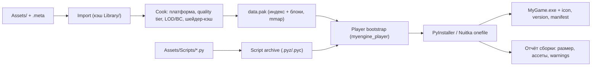
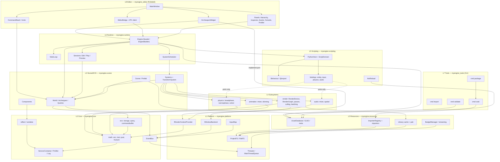
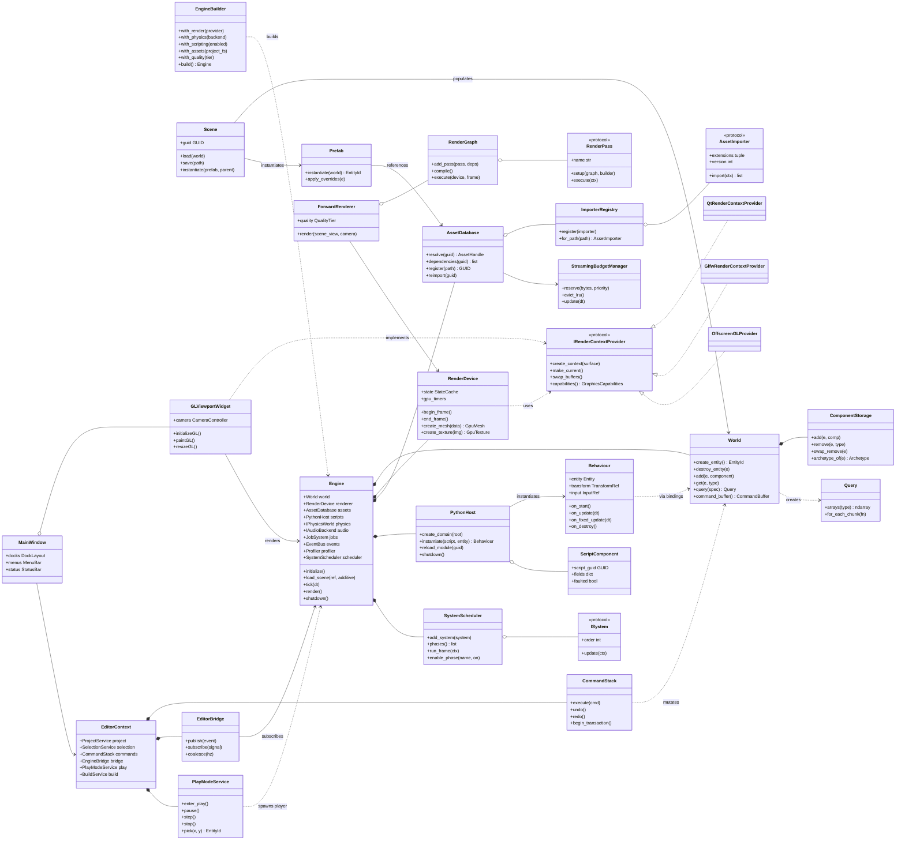
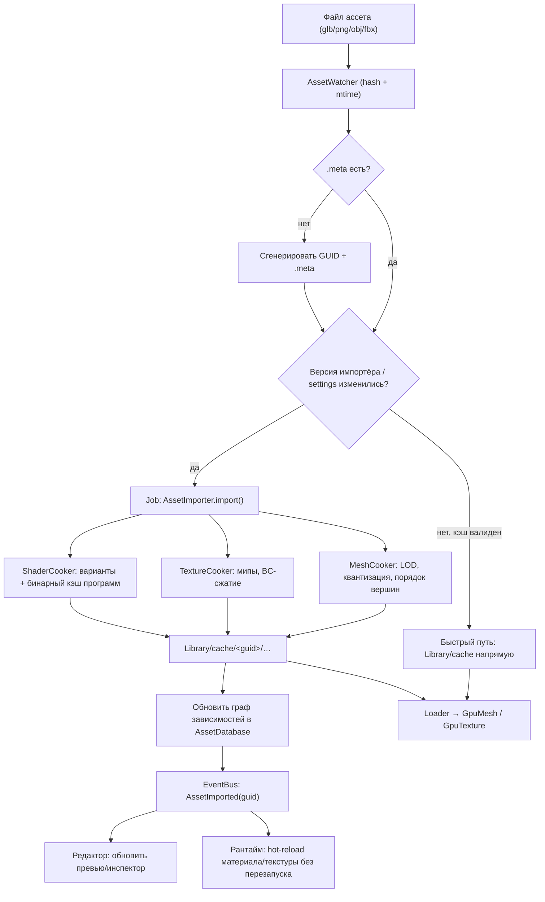
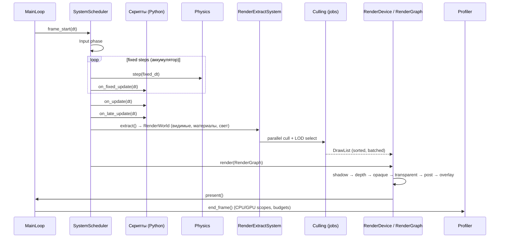

# MyEngine — высокоуровневая архитектура

Версия документа: 0.1 (design draft)
Статус: baseline для реализации M0–M6
Целевая платформа v1: Windows x64, GPU с OpenGL 3.3+ Core (минимум: Intel HD 4000-класс, 2–4 GB RAM)
Стек: Python 3.11+, PyOpenGL, PySide6 (только редактор), numpy, опциональные нативные ускорители

---

## 1. Резюме

MyEngine — модульный 3D-движок с data-oriented ядром (ECS), Python-скриптингом игровой логики и
редактором на PySide6. Ключевая идея: **один движок — три точки входа**.

| Точка входа | Пакет | GUI | Назначение |
|---|---|---|---|
| Редактор | `myengine_editor` | PySide6 | Авторинг сцен, ассетов, скриптов, сборка проекта |
| Плеер (рантайм) | `myengine_player` | Нет (только окно + GL) | Запуск собранной игры, экспорт в `.exe` |
| Инструменты | `myengine_tools` (CLI) | Нет | Импорт/кук/упаковка/валидация в CI |

Ядро (`myengine.core`, `myengine.render`, `myengine.scene`, `myengine.scripting`, ...) — общее.
Редактор зависит от ядра; ядро **никогда** не зависит от редактора и не зависит от PySide6/Qt.

Три правила, которые удерживают архитектуру от расползания:

1. **Правило зависимостей**: зависимости направлены сверху вниз по слоям (см. §3). Обратные
   связи — только через абстракции (ports), объявленные в нижнем слое.
2. **Правило двух GUI**: плеер не тянет Qt. Любая функциональность, нужная игре, живёт в ядре,
   а не в редакторе.
3. **Правило горячего пути**: код, исполняемый на каждой сущности каждый кадр, не создаёт
   Python-объектов; он работает batch-операциями над numpy-массивами или нативным кодом.

---

## 2. Ключевые архитектурные решения (ADR-сводка)

| # | Решение | Почему | Альтернатива и почему нет |
|---|---|---|---|
| ADR-1 | **ECS (archetype-based) как модель сцены** | Кэш-локальность, пакетная обработка в numpy, отсутствие per-entity Python-объектов в кадре | Unity-подобные GameObject+Component (удобно, но ~100× оверхед в Python на кадр); «чистый» OOP-граф сцены |
| ADR-2 | **Рендерер не знает про PySide6**; контекст GL подаётся через порт `IRenderContextProvider` | Один код рендера в редакторе (Qt-контекст), в плеере (GLFW/WGL) и в headless-тестах | Qt-специфичный рендер → невозможно собрать плеер без Qt |
| ADR-3 | **Play Mode по умолчанию — отдельный процесс** (`myengine_player`) | Изоляция падений, честный запуск, отсутствие «загрязнения» редактируемой сцены, горячая перезагрузка | In-process play (проще, но падение скрипта убивает редактор) — оставляем как быстрый preview-режим |
| ADR-4 | **Ассеты адресуются GUID, а не путями**; `.meta` рядом с файлом, кэш в `Library/` | Перемещение файлов не ломает ссылки; импорт отделён от использования; реимпорт по версии импортёра | Пути/имена как идентификаторы → хрупко, нет версионирования импорта |
| ADR-5 | **Математика на numpy, batch-first API** | Векторизация transform propagation, culling, skinning; numpy освобождает GIL в C-циклах | Чистые Python-классы Vec3/Mat4 (~50–200× медленнее) |
| ADR-6 | **Тяжёлые вычисления — офлайн (import/cook), рантайм только читает готовое** | На слабом железе нельзя декодировать PNG/генерировать мипы и LOD в кадре | Импорт «на лету» — фризы загрузки |
| ADR-7 | **Quality Tiers + адаптивное качество** | Целевое железо — интегрированная графика; нужен предсказуемый FPS | Один «максимальный» пресет (не поедет на Intel HD) |
| ADR-8 | **Python-скрипты — «логика», не «производительность»**; горячие системы — нативные/векторные | GIL + интерпретатор | Писать физику/рендер на Python — не масштабируется |
| ADR-9 | **Undo/Redo живёт только в редакторе** (Command stack), движок о нём не знает | Чистое ядро, редактор — единственный мутатор при авторинге | Undo внутри ECS → утечка редакторной политики в ядро |
| ADR-10 | **Сборка: PyInstaller (onedir/onefile) или Nuitka; player без Qt** | Требование «один .exe»; меньший размер и время старта без Qt | Тащить PySide6 в билд игры (+150–250 MB, +1–2 c старта) |

---

## 3. Слои и направление зависимостей

```
L8 Editor      myengine_editor      PySide6, панели, undo, gizmos, bridge
L7 Tools       myengine_tools       CLI: import / cook / package / validate
L6 Runtime     myengine.runtime     Engine facade, loop, sessions, scheduler
L5 Scripting   myengine.scripting   PythonHost, bindings, Behaviour, hot reload
L4 Subsystems  myengine.render | physics | animation | audio | ui
L3 Scene/ECS   myengine.scene       World, components, systems, prefabs, scenes
L2 Resources   myengine.resources   AssetDatabase, importers, cache, streaming
L1 Platform    myengine.platform    window, input, fs/VFS, GPU context, threads
L0 Core        myengine.core        math, ecs storage, events, jobs, reflect, serialize, di, log, profile
```

Правила:
- L(n) может импортировать L(0..n-1), но не L(n+1..).
- `render` **не** импортирует `scene`: рендер получает данные через «render world»/view-структуры
  (порт `IRenderScene`), а ECS-система рендера (в `scene.systems`) наполняет её. Это позволяет
  рендерить редакторные оверлеи и превью без сцены вообще.
- `scripting` не импортирует `render`/`physics` напрямую, только их порты (интерфейсы) — так
  скрипт-API не ломается при смене бэкенда.

---

## 4. Структура каталогов

```
MyEngine/
├─ pyproject.toml                 # одна дистрибуция, extras: [editor], [fbx], [dev], [cook]
├─ README.md
├─ docs/
│  ├─ ARCHITECTURE.md             # этот документ
│  ├─ ROADMAP.md
│  ├─ FORMATS.md                  # бинарные форматы: mesh, texture, pak, scene
│  └─ SCRIPTING.md                # API для геймдизайнера
├─ src/                           # логическая раскладка (см. §4.1: физически engine/ + editor/)
│  ├─ myengine/                   # ЯДРО + РАНТАЙМ (без Qt)
│  │  ├─ core/
│  │  │  ├─ math/                 # vec3, mat4, quat, transform, aabb, frustum, ray, plane
│  │  │  ├─ ecs/                  # entity, archetype, storage, query, world, commandbuffer
│  │  │  ├─ events/               # EventBus, Signal, EventQueue, typed channels
│  │  │  ├─ jobs/                 # JobSystem, TaskGraph, parallel_for, main-thread marshal
│  │  │  ├─ handles.py            # generational handles: EntityId, AssetHandle, ResourceId
│  │  │  ├─ reflect/              # TypeRegistry, PropertyInfo, экспорт полей для инспектора
│  │  │  ├─ serialize/            # JSON/binary codecs, версионирование, миграции
│  │  │  ├─ di.py                 # ServiceContainer (scoped: engine / session / editor)
│  │  │  ├─ log.py, time.py, profiler.py, memory.py (пулы), platform_info.py
│  │  ├─ platform/
│  │  │  ├─ fs.py                 # IFileSystem, ProjectFS, PakFS, overlay
│  │  │  ├─ window.py             # IWindow, IWindowBackend (GLFW/Win32), события окна
│  │  │  ├─ input.py              # InputState, InputMap (actions), девайсы
│  │  │  ├─ gpu/                  # IRenderContextProvider, GraphicsCapabilities, GL loader
│  │  │  └─ threads.py            # ThreadAffinity, MainThreadQueue
│  │  ├─ resources/
│  │  │  ├─ guid.py, meta.py      # генерация/парсинг GUID, чтение/запись .meta
│  │  │  ├─ asset_db.py           # AssetDatabase: реестр, зависимости, resolve(guid)
│  │  │  ├─ importer_registry.py  # ImporterRegistry: расширение → AssetImporter
│  │  │  ├─ importers/            # obj, gltf, fbx, stb_image (png/jpg), dds, material, shader, audio
│  │  │  ├─ cookers/              # MeshCooker, TextureCooker (мипы/BC), LODGenerator, ShaderCooker
│  │  │  ├─ formats/              # mesh_bin, tex_bin, mat_bin, pak (mmap), scene_bin
│  │  │  ├─ loaders/              # MeshLoader, TextureLoader, MaterialLoader, SceneLoader
│  │  │  ├─ streaming.py          # BudgetManager, LRU VRAM/RAM кэш, приоритеты загрузки
│  │  │  └─ hot_reload.py         # watch → reimport → событие обновления ресурса
│  │  ├─ scene/
│  │  │  ├─ components/           # transform, hierarchy, mesh_renderer, camera, light, collider,
│  │  │  │                        # rigidbody, animator, audio_source, script, tags, active_state
│  │  │  ├─ systems/              # TransformSystem, HierarchySystem, RenderExtractSystem, ...
│  │  │  ├─ world_factory.py      # сборка World + регистрация компонентов/систем
│  │  │  ├─ scene.py              # Scene (документ), SceneRegistry, аддитивные сцены
│  │  │  ├─ prefab.py             # Prefab, instantiate, overrides
│  │  │  └─ selection.py          # SelectionModel (нейтральная, без Qt)
│  │  ├─ render/
│  │  │  ├─ context.py            # IRenderContextProvider, IRenderSurface, RenderThreadPolicy
│  │  │  ├─ device.py             # RenderDevice (фасад: state, ресурсы, кадры)
│  │  │  ├─ gl/                   # gl_api, state_cache, buffer, texture, shader, program,
│  │  │  │                        # vertex_array, framebuffer, queries, debug_marker
│  │  │  ├─ resources/            # GpuMesh, GpuTexture, GpuMaterial, GpuShader, RenderTarget
│  │  │  ├─ graph/                # RenderGraph, RenderPassNode, resource aliasing/transient
│  │  │  ├─ passes/               # DepthPrepass, ShadowCSM, Opaque, Transparent, Skybox,
│  │  │  │                        # PostFX, Grid, Gizmo, SelectionOutline, DebugDraw
│  │  │  ├─ pipeline/             # ForwardRenderer, quality tiers, feature toggles
│  │  │  ├─ culling/              # FrustumCuller, BVHScene, LodSelector, OcclusionPolicy
│  │  │  ├─ batching/             # StaticBatcher, InstancingPool, MaterialSorter, DrawList
│  │  │  ├─ shaders/              # GLSL + #include-препроцессор + варианты (keywords)
│  │  │  ├─ camera.py             # Camera, view/proj, jitter, pickspace
│  │  │  └─ overlay.py            # IOverlayRenderer (gizmos/grid/handles) — порт для редактора
│  │  ├─ physics/
│  │  │  ├─ api.py                # IPhysicsWorld, BodyHandle, CollisionEvent
│  │  │  ├─ shape.py              # box/sphere/capsule/mesh/heightfield
│  │  │  ├─ broadphase.py         # SweepAndPrune / uniform grid
│  │  │  ├─ narrowphase.py        # GJK/EPA, SAT
│  │  │  ├─ solver.py             # последовательный импульсный солвер, islands, sleeping
│  │  │  ├─ query.py              # raycast, shapecast, overlap
│  │  │  └─ backends/             # builtin (Python/numpy), pybullet-адаптер (опционально)
│  │  ├─ animation/
│  │  │  ├─ skeleton.py, clip.py, mixer.py, state_machine.py
│  │  │  ├─ skinning.py           # CPU (batch/numpy) и GPU (texture-паллета) пути
│  │  │  └─ ik.py                 # FABRIK/CCD, опционально
│  │  ├─ audio/
│  │  │  ├─ api.py                # IAudioBackend, AudioSource, AudioListener
│  │  │  ├─ mixer.py, spatial.py  # 2D/3D панорама, дистанционные кривые
│  │  │  └─ backends/             # miniaudio (pyminiaudio) / OpenAL (PyOpenAL)
│  │  ├─ scripting/
│  │  │  ├─ host.py               # PythonHost: домены, импорт модулей из проекта
│  │  │  ├─ domain.py             # ScriptDomain: изолированные sys.modules/namespace
│  │  │  ├─ behaviour.py          # Behaviour (базовый класс скрипта), lifecycle-хуки
│  │  │  ├─ fields.py             # @export / @range / @asset_ref — метаданные для инспектора
│  │  │  ├─ bindings/             # API-модули: entity, transform, input, time, physics,
│  │  │  │                        # audio, prefabs, events, components, debug, math
│  │  │  ├─ marshal.py            # перевод numpy/handle ↔ Python-значения на границе API
│  │  │  ├─ hot_reload.py         # перезагрузка модулей + снапшот/восстановление полей
│  │  │  └─ sandbox.py            # опциональные ограничения (imports, io, время на кадр)
│  │  └─ runtime/
│  │     ├─ engine.py             # Engine facade + EngineBuilder
│  │     ├─ loop.py               # MainLoop: fixed timestep, интерполяция, frame pacing
│  │     ├─ scheduler.py          # SystemScheduler: фазы, порядок, профилирование
│  │     ├─ sessions.py           # ISession: EditSession / PlaySession / HeadlessSession
│  │     ├─ config.py             # RuntimeConfig, QualityTier, ProjectSettings
│  │     └─ crash.py              # обработчик падений, лог, minidump-хук
│  ├─ myengine_editor/            # РЕДАКТОР (PySide6)
│  │  ├─ app.py                   # bootstrap QApplication, DI, тема, восстановление layout
│  │  ├─ main_window.py           # QMainWindow, доки, меню, шорткаты, статусбар
│  │  ├─ theme/                   # design tokens, QSS, иконки (SVG), dark/light, HiDPI
│  │  ├─ panels/
│  │  │  ├─ hierarchy_panel.py    # QAbstractItemModel над ECS-иерархией
│  │  │  ├─ inspector_panel.py    # авто-UI из reflect-метаданных компонентов
│  │  │  ├─ asset_browser.py      # виртуальные папки, drag&drop, превью, фильтры
│  │  │  ├─ console_panel.py      # логи движка/скриптов, фильтр, ссылки на исходник
│  │  │  ├─ profiler_panel.py     # CPU/GPU scopes, графики, бюджеты кадра
│  │  │  ├─ statistics_panel.py   # draw calls, tri, VRAM, GC, FPS
│  │  │  ├─ material_editor.py, animation_timeline.py, shader_editor.py
│  │  │  ├─ build_settings_panel.py, project_settings_panel.py
│  │  │  └─ script_editor_stub.py # открыть во внешнем редакторе / встроенный (опц.)
│  │  ├─ viewport/
│  │  │  ├─ gl_viewport.py        # QOpenGLWidget: владеет контекстом, вызывает Engine.render
│  │  │  ├─ qt_context.py         # QtRenderContextProvider (реализация порта)
│  │  │  ├─ camera_controller.py  # орбита/пан/зум, WASD-fly, фокус на выделении
│  │  │  ├─ gizmo_controller.py   # translate/rotate/scale, snapping, локальные оси
│  │  │  ├─ picking.py            # GPU id-buffer picking / CPU BVH fallback
│  │  │  └─ overlays.py           # сетка, коллайдеры, свет, камера, статистика
│  │  ├─ models/                  # SceneTreeModel, AssetTreeModel, PropertyModel, LogModel
│  │  ├─ commands/                # CommandStack, Command (undo/redo), транзакции, merge
│  │  ├─ services/
│  │  │  ├─ editor_context.py     # EditorContext (DI-фасад редактора)
│  │  │  ├─ project_service.py    # открыть/создать/сохранить проект, недавние
│  │  │  ├─ play_mode_service.py  # spawn/kill player, IPC, pause/step/stop
│  │  │  ├─ build_service.py      # запуск cook+package как background job, прогресс
│  │  │  └─ settings_service.py   # настройки редактора (QSettings/JSON)
│  │  ├─ bridge/
│  │  │  ├─ engine_bridge.py      # движок → Qt-сигналы, coalescing, маршалинг в GUI-поток
│  │  │  ├─ ipc_client.py         # JSON-RPC клиент к плееру (named pipe / TCP loopback)
│  │  │  └─ progress.py           # адаптер JobSystem → QProgressDialog/QStatusBar
│  │  └─ dialogs/                 # импорт-настройки, build, preferences, about, crash
│  ├─ myengine_player/            # РАНТАЙМ-ЗАПУСК
│  │  ├─ __main__.py              # парсинг аргументов: --project, --scene, --pak, --windowed
│  │  ├─ app.py                   # окно (GLFW/Win32), splash, загрузка пака, главный цикл
│  │  ├─ frame_pacing.py          # vsync/ограничение FPS, приоритеты потоков
│  │  └─ diagnostics.py           # оверлей FPS/логов, hotkeys, crash-лог
│  └─ myengine_tools/             # CLI
│     ├─ __main__.py              # myengine <command>
│     ├─ cmd_import.py, cmd_cook.py, cmd_package.py, cmd_validate.py, cmd_new_project.py
│     └─ packaging/               # pyinstaller specs, nuitka build, manifest/иконка/версия
├─ tests/
│  ├─ unit/                       # math, ecs, serialize, importers
│  ├─ integration/                # headless-сессия, загрузка сцены, скрипты
│  ├─ golden/                     # image-diff рендера (offscreen FBO → png)
│  └─ fixtures/
├─ tools/                         # dev-скрипты: benchmark, профилирование, генерация иконок
├─ samples/                       # пример проекта (LowPolyDemo) + скрипты
└─ Library/                       # кэш импорта (git-ignored), создаётся движком
```

### 4.1 Соответствие уже созданному каркасу репозитория

В корне репозитория уже существуют `engine/`, `editor/`, `scripts/`, `assets/`, `build/`, `docs/`.
Дерево выше — логическая раскладка; физически она укладывается в этот каркас так:

| Существующий каталог | Содержимое |
|---|---|
| `engine/` | Python-пакет верхнего уровня: публичный вход — `import engine.core` |
| `engine/core/` | **ядро** (реализовано, см. §19): `math3d`, `component`, `game_object`, `transform`, `scene`, `system`, `event_bus`, `game_loop`, `log` |
| `engine/core/resources/` | подсистема ресурсов: `asset`, `loader`, `resource_manager`, `loaders/` (OBJ, изображения/DDS, GLSL), `primitives` (куб, сфера, плоскость, сетка) |
| `engine/rendering/` | **рендеринг** (реализовано, см. §19): контекст и настройки, кэш состояния, шейдеры и варианты, меши/текстуры/материалы, камера, граф проходов с MRT, forward-рендерер, Qt-адаптеры (`qt_context`, `qt_viewport`) |
| `engine/core/platform/`, `physics/`, `animation/`, `audio/`, `scripting/`, `runtime/` | следующие слои (появляются на M2–M6) |
| `engine/myengine_tools/` | CLI-пакет: `cmd_import`, `cmd_cook`, `cmd_package`, `cmd_validate`, `cmd_new_project` |
| `engine/tests/` | тесты ядра: 146 тестов pytest, свои фикстуры (см. `engine/tests/conftest.py`) |
| `editor/` | **редактор** (реализовано, см. §19): `app`, `main_window`, `context`, `panels/` (иерархия, инспектор, ассеты, консоль, статистика), `viewport/`, `models/`, `theme/` (QSS + иконки), `i18n/` (ru/en), `scene_io` |
| `editor/tests/` | тесты редактора (модели, команды, undo) |
| `scripts/` | тонкие точки входа и dev-утилиты: `run_demo.py`, `render_offscreen.py` (headless-рендер в PNG), `run_viewer.py` (окно), `run_editor.py`, `run_player.py`, `myengine_cli.py`, `build_exe.py` |
| `tools/` | dev-инструменты: `benchmark_core.py` (замеры ядра) |
| `assets/` | ресурсы движка: `shaders/*.vert|frag|glsl` (lit, unlit, common), `icons/*.svg`, `primitives/*.obj`, `fonts/`, `default_materials/`, `templates/` |
| `build/packaging/` | spec-файлы PyInstaller/Nuitka, иконка, version-ресурс, манифест |
| `build/artifacts/` | результат сборки (git-ignored) |
| `docs/` | архитектура, `CORE.md` (API ядра), `FORMATS.md`, `SCRIPTING.md` |
| `samples/` | пример проекта `LowPolyDemo` (появляется на M2) |
| `_work/` | временные файлы тестов и скриптов (git-ignored) |
| `Library/` | кэш импорта/кука (git-ignored, генерируется движком) |

`pyproject.toml` — одна дистрибуция с несколькими пакетами и extras:

```toml
[project]
name = "myengine"
requires-python = ">=3.10"
dependencies = ["numpy>=1.24"]

[project.optional-dependencies]
editor = ["PySide6>=6.6"]     # тянет только редактор, не плеер
fbx    = ["ufbx"]             # или assimp — тяжёлая нативная зависимость
audio  = ["miniaudio"]
cook   = ["compressonator-cli"]  # внешний CLI для BC-сжатия текстур
dev    = ["pytest>=8", "ruff>=0.6", "watchdog"]

[project.scripts]
myengine = "myengine_tools.__main__:main"     # CLI: import / cook / package / validate

[tool.setuptools]
packages = ["engine", "engine.core", "engine.core.resources",
            "engine.core.resources.loaders"]
```

Правило зависимостей неизменно: `engine.core` не импортирует `editor.myengine_editor` и не
зависит от PySide6/OpenGL. Оно проверяется автоматически — `test_layering.py` разберёт импорты
по AST и завалит CI на запрещённом ребре зависимостей.


Структура проекта пользователя (то, что создаёт `myengine new`):

```
MyGame/
├─ MyGame.project.json        # манифест: имя, версия движка, стартовая сцена, quality tier
├─ Assets/
│  ├─ Scenes/main.scene.json
│  ├─ Scripts/player_controller.py
│  ├─ Models/*.glb (+ .meta)
│  ├─ Textures/*.png|dds (+ .meta)
│  └─ Materials/*.mat.json
├─ Settings/                  # input map, physics, layers, audio, graphics
├─ Packages/                  # опциональные пакеты ассетов (общие библиотеки)
├─ Library/                   # кэш импорта/кука (генерируется, git-ignored)
└─ Build/                     # результат сборки: pak + exe
```

---

## 5. Ядро: ECS, события, задания, рефлексия

### 5.1 ECS

```python
# myengine/core/ecs/entity.py
EntityId = int          # 32 бита индекс | 32 бита поколение; 0 = invalid (null entity)

# myengine/core/ecs/archetype.py
class Archetype:        # набор типов компонентов → contiguous numpy-массивы колонок
    mask: ComponentMask
    columns: dict[type[Component], np.ndarray]   # shape (capacity, ) structured dtype
    entities: np.ndarray                          # EntityId по слотам
    count: int

# myengine/core/ecs/storage.py
class ComponentStorage:  # archetype-переходы, добавление/удаление без утечек слотов
    def add(entity, component) -> None
    def remove(entity, comp_type) -> None
    def swap_remove(entity) -> None      # O(1), сохраняет плотность

# myengine/core/ecs/query.py
class Query:             # компилируется в список (archetype, mask) — обход без проверок в цикле
    def __init__(self, with_=(), without=(), any_of=()): ...
    def arrays(self, comp_type) -> np.ndarray        # batch-доступ
    def for_each_chunk(self, fn) -> None             # (archetype, slice) → fn

# myengine/core/ecs/world.py
class World:
    def create_entity(self) -> EntityId
    def destroy_entity(self, e) -> None
    def add(self, e, comp) -> None
    def get(self, e, comp_type)
    def query(self, *spec) -> Query
    def command_buffer(self) -> CommandBuffer        # отложенные структурные изменения
```

Почему archetype: системы читают `np.ndarray` целиком (`positions[:n] @ matrix.T`), а не гоняют
Python-цикл по сущностям. Структурные изменения (add/remove) во время итерации запрещены —
используется `CommandBuffer`, который применяется в конце фазы (детерминизм + отсутствие
инвалидации итераторов).

`Component` — не класс с логикой, а описание данных (`@dataclass(slots=True)` + numpy dtype).
Логика — в системах и скриптах.

### 5.2 Системы и планировщик

```python
class ISystem(Protocol):
    order: int                     # внутри фазы
    def on_add(self, world: World) -> None: ...
    def on_remove(self, world: World) -> None: ...
    def update(self, ctx: SystemContext) -> None: ...
```

Фазы кадра (`SystemScheduler`):

```
FrameStart
 ├─ Input         (сбор ввода, действия)
 ├─ FixedUpdate   (0..N раз, фикс. dt=1/60; физика, скрипты on_fixed_update)
 ├─ Update        (переменный dt; игровая логика, скрипты on_update, анимация)
 ├─ LateUpdate    (камера, иерархия, IK, скрипты on_late_update)
 ├─ Extract       (ECS → RenderWorld: видимые объекты, материалы, свет)
 ├─ Culling       (параллельно по фрустумам, BVH)
 ├─ Render        (RenderGraph: shadow → depth → opaque → transparent → post → overlay)
 ├─ Present
 └─ FrameEnd      (профайлер, статистика, сборка мусора с бюджетом, GC-пауза)
```

Планировщик поддерживает включение/выключение фаз (редакторный режим без `FixedUpdate`),
подписку на «одноразовые» системы (импорт, bake) и профильные scope-хуки.

### 5.3 EventBus

Типизированные каналы, подписки со слабыми ссылками, очередь событий кадра и «немедленная»
доставка, маршалинг в главный поток через `MainThreadQueue`. События — frozen dataclass;
для горячих событий (столкновения) — пул объектов с `recycle()`.

### 5.4 JobSystem

Пул потоков `N = max(1, cpu_count - 1)` для IO/импорта/кука/параллельного culling;
`parallel_for(n, fn, chunk)` для numpy-совместимых задач; `TaskGraph` с зависимостями для
пайплайна загрузки; `ThreadAffinity` — гарантия, что GL и Qt API вызываются только из главного
потока (в debug-сборке — assert).

### 5.5 Reflection / сериализация

`TypeRegistry` хранит `PropertyInfo` (имя, тип, диапазон, tooltip, asset-kind) для компонентов и
для `Behaviour`-полей. Отсюда автоматически строятся:
- инспектор в редакторе (редактор не хардкодит поля),
- JSON-сериализация сцен и префабов,
- миграции форматов (version → upgrade-функции),
- CLI-валидация сцен.

---

## 6. Ресурсы и ассет-пайплайн

### 6.1 Идентификация

```
Assets/Models/hero.glb
Assets/Models/hero.glb.meta      → {"guid":"8f3c…","importer":"gltf","version":3,
                                    "settings":{"scale":1.0,"generate_lods":true,...}}
Library/8f/8f3c…/mesh.bin        → кукованный меш (mmap-friendly, выровненные атрибуты)
```

Ссылки в сценах/материалах — только GUID. Реестр `AssetDatabase` строит граф зависимостей
(mesh → material → texture → shader), что даёт: инкрементальный реимпорт, точный расчёт
содержимого пака, поиск «битых» ссылок, поиск неиспользуемых ассетов.

### 6.2 Импортёры (порт + реестр плагинов)

```python
class AssetImporter(Protocol):
    extensions: tuple[str, ...]
    version: int                       # рост версии → авто-реимпорт
    def inspect(self, path) -> AssetPreview
    def import(self, ctx: ImportContext) -> list[Artifact]   # артефакты → Library/
```

| Формат | Реализация v1 | Заметка |
|---|---|---|
| `.obj` | собственный парсер (быстрый, low-poly) | без MTL-материалов сверх базовых |
| `.gltf` / `.glb` | `pygltflib` + собственная сборка мешей | основной рекомендованный формат v1 |
| `.fbx` | адаптер `ufbx`/Assimp (extra `[fbx]`) | тяжёлая нативная зависимость, вынесена в extra |
| `.png` / `.jpg` | `stb_image` (через `py-stb`/`Pillow`) | конвертация в `tex_bin` + мипы на импорте |
| `.dds` | собственный парсер заголовка + прямая загрузка блоков | BC1/BC3/BC5 без перекодирования |
| `.mat.json`, `.glsl` | материал/шейдер-импортёр | собирает variants-ключи |

Импорт всегда идёт в job-потоке, прогресс — через EventBus, редактор показывает его в статусбаре.

### 6.3 Кук и упаковка данных

`MeshCooker` — переупорядочивание вершин (post-transform cache friendly), квантизация
позиций/нормалей (int16 + scale), генерация LOD0..2 (vertex clustering / quadric decimation) —
**офлайн**. `TextureCooker` — мипы, при необходимости BC-сжатие внешним CLI
(`texconv`/`compressonator`, extra `[cook]`). `PakBuilder` собирает `data.pak` (индекс +
сжатые блоки + mmap-доступ), чтобы рантайм читал данные без распаковки всего архива.

### 6.4 Streaming и бюджет памяти

`BudgetManager` держит лимиты (RAM/VRAM/время загрузки), `LRU`-эвикция, приоритеты
(сцена → префабы → предзагрузка соседних комнат), асинхронная подгрузка с placeholder-ресурсом,
чтобы не было фризов. На слабом железе — жёсткий лимит VRAM (например, 256 MB) и отказ от
загрузки текстур > 1024² без мипов.

---

## 7. Рендеринг

### 7.1 Абстракция контекста (ключ к разделению с редактором)

```python
class IRenderContextProvider(Protocol):
    def create_context(self, surface: IRenderSurface) -> None: ...
    def make_current(self) -> None: ...
    def swap_buffers(self) -> None: ...
    def capabilities(self) -> GraphicsCapabilities: ...
    def shutdown(self) -> None: ...

class IRenderSurface(Protocol):        # то, во что рисуем: окно плеера, QOpenGLWidget, FBO
    def size(self) -> tuple[int, int]: ...
    def dpi_scale(self) -> float: ...
    def is_offscreen(self) -> bool: ...
```

Реализации: `QtRenderContextProvider` (редактор: контекст создаёт Qt, движок его оборачивает,
рисует в FBO виджета), `GlfwRenderContextProvider` (плеер), `OffscreenGLProvider`
(headless-тесты, генерация превью-иконок ассетов, golden-тесты в CI).

`RenderDevice` — единственная точка доступа к GL: `gl/*` обёртки, `StateCache`
(не переключать состояние без нужды — критично для слабых драйверов), `BufferPool`,
`TexturePool`, `FramebufferPool`, отладочные маркеры (`KHR_debug`) и GPU-таймеры.

### 7.2 Render Graph и проходы

`RenderGraph` строит граф проходов с транзитными ресурсами (aliasing памяти под render targets)
и автоматическими барьерами/очисткой (в GL — управление FBO и `glMemoryBarrier`, при наличии).

Порядок ForwardRenderer:
1. `DepthPrepass` (опционально; включается для сцен с овердрау), 
2. `ShadowCSM` (1–2 каскада на low tier, 3–4 на high; PCF 3×3),
3. `Opaque` (сортировка по material → минимум смен состояния),
4. `Skybox`,
5. `Transparent` (back-to-front, без записи в depth),
6. `PostFX` (tone map, FXAA; bloom/SSAO только high tier),
7. `Overlay` (gizmos, сетка, коллайдеры, outline выделения — только в редакторе).

Шейдеры — GLSL 330 core с `#include`-препроцессором и keyword-вариантами
(`USE_SHADOW`, `USE_SKINNING`, `INSTANCED`), компиляция — в фоне при импорте/старте, кэш
бинарников (`glGetProgramBinary`) рядом с проектом, чтобы не компилировать на каждом старте.

### 7.3 Оптимизация под слабое железо

| Приём | Что даёт |
|---|---|
| Frustum + BVH-culling, векторизованный | −50…80 % draw calls на типичной сцене |
| Static batching (merge статики по материалу) | один draw call на «остров» геометрии |
| GPU instancing (трава, пропсы, деревья) | тысячи объектов в 1–5 draw calls |
| Авто-LOD (офлайн) + distance/importance переключение | стабильный tri-budget |
| Текстурные атласы для мелких объектов, texture array | меньше переключений, лучше кэш |
| Depth prepass + early-Z | меньше затенённых фрагментов |
| Качество по тирам (Low/Medium/High) | предсказуемый FPS на интегрированной графике |
| Адаптивное качество в рантайме | при просадке ниже бюджета кадра: отключить пост-FX → понизить тени → render scale 0.75 |
| Пул объектов и арен памяти | отсутствие аллокаций в кадре, меньше GC-пауз |
| mmap-ассеты + прямая загрузка в VBO | загрузка без промежуточных копий |

Бюджеты кадра (target 30/60 FPS на low tier): CPU-логика ≤ 6 мс, culling ≤ 1.5 мс,
draw ≤ 2 мс, draw calls ≤ 300, tri ≤ 300 k, VRAM ≤ 256 MB, скрипты ≤ 2 мс.
Профайлер в редакторе показывает превышение бюджета красным — это часть DX движка.

---

## 8. Физика, анимация, аудио

**Физика.** `IPhysicsWorld` (порт) + две реализации: встроенная (broadphase SAP/grid,
narrowphase GJK/EPA + SAT для боксов, последовательный импульсный солвер с islands и sleeping,
numpy-векторизация интеграции) и адаптер `pybullet`/`Bullet` для сложных случаев (extra).
Встроенная реализация хранит тела и коллайдеры в SoA-массивах (`BodyStore`/`ColliderStore`,
`RigidBody`/`Collider` — фасады над строками), а горячие пути — куб–куб и солвер —
работают пачками (`box_box_batch`, `solve_batch`; подробности и список ещё поштучных
путей — `docs/CORE.md` §7.1).
Fixed timestep 1/60 с аккумулятором и интерполяцией трансформов в `LateUpdate`. Raycast/
shapecast/overlap — через BVH-структуру, общей с рендер-culling (одна BVH на сцену, перестройка
инкрементальная). Детерминизм: фиксированный порядок solver-итераций, сортировка контактов.

**Анимация.** Скелет (паллета ≤ 128 костей для совместимости с uniform-массивами на GL 3.3),
клипы (кватернионные дорожки, сжатие офлайн), `AnimationMixer` с блендингом и слоями,
`StateMachine` для переходов, IK опционально. Скиннинг: CPU batch (numpy) по умолчанию на very
low tier, GPU (texture-паллета) при наличии; выбор — через capabilities.

**Аудио.** `IAudioBackend` + адаптеры (`miniaudio` — лёгкий, рекомендуется; OpenAL — extra).
Потоковый и in-memory воспроизводитель, 3D-панорама/аттенюация, шины (master/music/sfx/voice),
пул голосов с приоритетами, чтобы на слабом CPU не плодить потоки.

---

## 9. Скриптинг на Python

### 9.1 Модель исполнения

```python
# Assets/Scripts/player_controller.py
from myengine.scripting import Behaviour, export, asset_ref, Entity

class PlayerController(Behaviour):
    speed: float = export(6.0, range=(0, 20), tooltip="м/с")
    jump_force: float = export(7.5, range=(0, 30))
    camera: Entity = export(None, kind="entity_ref")
    footstep: "AudioClip" = asset_ref(kind="audio")

    def on_start(self): self._vel = 0.0
    def on_fixed_update(self, dt: float):
        move = self.input.axis("Move")           # InputMap-действие
        self.transform.translate(move * self.speed * dt)
        if self.input.pressed("Jump"): self._vel = self.jump_force
    def on_update(self, dt: float): ...
    def on_collision_enter(self, other: Entity): ...
    def on_destroy(self): ...
```

- `PythonHost` создаёт `ScriptDomain` для проекта: изолированный namespace, `Assets/Scripts`
  в `sys.path`, `myengine.scripting` предоставляет только публичный API (внутренние модули
  недоступны через `__all__`-барьер).
- `ScriptComponent` (ECS) хранит `script_guid + serialized_fields`; инстанцирование — при
  загрузке сцены; хуки вызываются системами `ScriptSystem` (Update) и `PhysicsScriptSystem`
  (FixedUpdate) — **скрипты не тикают сами**, их вызывает планировщик (детерминизм).
- **Границы API тонкие**: `transform.translate(vec)` не создаёт объектов — `marshal` пишет
  прямо в numpy-строку компонента. Возврат значений — примитивы/handles, не объекты ECS.
- **Ошибки скриптов изолированы**: исключение логируется с трассировкой и ссылкой на строку,
  скрипт помечается «faulted» и (по настройке) отключается, кадр не падает. В редакторе — jump
  to source в консоли.

### 9.2 Hot reload

`watchdog` ловит изменение `.py` → перезагрузка модуля в домене → сохранение значений
`@export`-полей существующих инстансов → пересоздание классов → восстановление полей.
Структурные изменения (переименование класса, новые обязательные поля) обрабатываются
best-effort с логом. В Play Mode (отдельный процесс) — перезапуск с восстановлением из снапшота
или (v2) «горячая» подмена через IPC.

### 9.3 Производительность скриптов

`ScriptSystem` собирает скрипты в batch по архетипу, вызывает хуки через предкомпилированные
таблицы (без `getattr` в цикле), есть бюджет на кадр (`max_script_ms`) с логированием нарушителей.
Тяжёлое из скриптов выносится в jobs/нативные системы (документируется в `SCRIPTING.md`).

### 9.4 Реализовано сейчас (M4, первый шаг скриптинга; A2a/A2b: Behaviour — A2 закрыт)

**A3a — планировщик:** `engine/core/scheduling` (`Scheduler` в `Scene.scheduler`, `after`/`every`, корутины `Wait`/`WaitForFrame`/`WaitForFixed`/`WaitUntil`; часы GAME / GAME_RAW / UI, пауза через `game_paused`) — см. `docs/CORE.md` §7.4. **A3b:** твины (`tween`, 8 easing), методы `self.after/every/wait*/start_coroutine/tween/cancel/cancel_all` в `Behaviour` и функциональных скриптах (автоочистка при `on_destroy`, отмена при hot reload), логирование ошибок задач с троттлингом, `Scene.tick_scheduler_ui` — A3 закрыт.

Раздел 9.1 описывает целевую модель (`Behaviour` + `@export` + рефлексия). Первый шаг
сделан проще и уже работает — **функциональные хуки** без классов и без рефлексии:

| Модуль | Содержимое |
|---|---|
| `engine/scripting/runtime.py` | `ScriptRuntime` — реестр исполняемых скриптов, `load_module`/`compile_source`, песочница импортов (`ALLOWED_MODULES` + `ALLOWED_ROOTS`), `format_traceback`, горячая перезагрузка `refresh`/`reload` |
| `engine/scripting/script_component.py` | `ScriptComponent` (ECS): `on_start`/`on_update`/`on_destroy` компонента → одноимённые функции скрипта, `InputState`, `ScriptTime`, API `self.game_object/scene/transform/input/time/log()` |
| `engine/scripting/syntax.py` | ключевые слова, встроенные имена, публичный API движка, цвета токенов (Qt не нужен — модуль headless) |
| `engine/scripting/python_highlighter.py` | `PythonHighlighter(QSyntaxHighlighter)`: правила подсветки, многострочные строки через состояния блоков, отдельный цвет для `self.<api>` |
| `editor/panels/code_editor.py` | `CodeEditor(QPlainTextEdit)`: нумерация строк, автоотступ по `:`, Tab/Shift+Tab, парные скобки и подсветка пары, `QCompleter`, JetBrains Mono, Ctrl+/ |
| `editor/panels/find_replace.py` | `FindReplaceDialog`: поиск/замена, регистр, слово целиком, «заменить всё» |
| `editor/panels/script_editor.py` | `ScriptEditorPanel`: дерево `*.py`, вкладки, тулбар (создать/открыть/сохранить/сохранить всё/запустить/стоп/перезагрузить), консоль, `ScriptRunner` (тик компонентов + горячая перезагрузка) |

Отличия от целевой модели (осознанные, снимаются на следующих шагах):

- **Хуки — функции модуля** (A2a добавил рядом `Behaviour`+`@export`, см.
  `docs/SCRIPTING.md`; класс в модуле выигрывает у функций): `on_start(self)`
  получает компонент, поэтому `self` уже даёт доступ к движку.
- **Изоляция — на уровне модуля**: `types.ModuleType` + собственный
  `__builtins__` и словарь-пространство имён на каждый экземпляр, поэтому два
  скрипта (и два экземпляра одного файла) не делят переменные. Настоящей
  песочницы безопасности нет и быть не может внутри процесса: белый список
  импортов закрывает `os`/`subprocess`/`sys` и произвольное `eval`/`open`,
  но это защита от опечатки, а не граница доверия.
- **Горячая перезагрузка** сохраняет имена, которых нет в новой версии
  (`previous`-словарь), вызывает у прежней версии `on_destroy`, у новой —
  `on_start` и `on_reload`, и пишет в лог предупреждение о возможных утечках:
  объекты функций живут, пока на них ссылаются сигналы, таймеры и замыкания.
  У `Behaviour` (A2b) состояние `__dict__` переносится в новый экземпляр,
  `on_start` повторно не вызывается; подробности — `docs/SCRIPTING.md`.
- **Тик скриптов** делает `ScriptRunner` редактора (таймер 16 мс), а не
  `ScriptSystem` планировщика: сцена по-прежнему обновляется сама, когда её
  обновляет игровой цикл.

---

## 10. Runtime: Engine facade и сессии

```python
class Engine:
    world: World; renderer: RenderDevice; assets: AssetDatabase
    scripts: PythonHost; physics: IPhysicsWorld; audio: IAudioBackend
    jobs: JobSystem; events: EventBus; profiler: Profiler; scheduler: SystemScheduler

    @staticmethod
    def builder() -> "EngineBuilder": ...
    def initialize(self) -> None: ...
    def load_scene(self, ref: AssetRef, additive=False) -> Scene: ...
    def tick(self, dt: float) -> None: ...
    def render(self) -> None: ...
    def shutdown(self) -> None: ...
```

`EngineBuilder` собирает движок из «фич» (`RenderFeature`, `PhysicsFeature`, `ScriptFeature`,
`AudioFeature`) и конфигурации — так плеер не тянет ненужные подсистемы (важно для размера exe
и времени старта).

`ISession`:
- `EditSession` — сцена открыта, рендер работает, игровые системы (физика/скрипты/анимация)
  выключены; доступны инструменты редактора.
- `PlaySession` — полный набор систем, опционально headless (для автотестов и CI).
- `PreviewSession` — in-process play без изоляции (быстрый запуск, риск падения редактора).

`MainLoop` — фиксированный шаг симуляции + интерполяция, ограничение FPS, обработка
сворачивания окна (пауза рендера, чтобы не жечь GPU), hotkeys.

---

## 11. Редактор (PySide6)

### 11.1 Владелец GL-контекста

`GLViewportWidget(QOpenGLWidget)` создаёт Qt-контекст (Core Profile 3.3+, depth 24, stencil 8,
samples 4 по возможности) и передаёт движку `QtRenderContextProvider`. Движок рисует
непосредственно в default framebuffer виджета через `paintGL` → `Engine.render()`. Это
единственное место пересечения Qt и GL; всё остальное общается с движком через `EditorBridge`.

Почему так, а не отдельный render thread: на слабом железе синхронизация двух контекстов и
лишняя копия кадра дороже, чем выигрыш. Render thread (`SharedContextRenderThread` с command
queue) предусмотрен как опция v2 и уже учтён в архитектуре (все вызовы рендера идут через
`RenderDevice`, а не напрямую из панелей).

### 11.2 Панели и UX

- **Hierarchy** — дерево сущностей над ECS-иерархией (`Hierarchy`-компонент, parent/child),
  drag&drop, контекстное меню, мультивыделение, поиск/фильтр по компоненту.
- **Inspector** — авто-UI из `reflect`-метаданных: числа/слайдеры, цвета, кривые, ссылки на
  ассеты (drag&drop из Asset Browser), entity-picker, кнопки действий. Один и тот же код рисует
  компоненты движка и `@export`-поля скриптов.
- **Asset Browser** — виртуальные папки, превью (иконка-рендер через offscreen GL в фоне),
  поиск/теги, импорт-настройки в отдельной вкладке, «Reimport», «Show in Explorer».
- **Console / Profiler / Statistics** — логи с уровнями и фильтрами; CPU-scope дерево и GPU-
  таймеры; draw calls, tri, VRAM, FPS, GC-паузы.
- **Material/Shader/Animation редакторы**, **Build Settings**, **Project Settings**.

Тема: единые design tokens (цвета, типографика, отступы, радиусы), QSS-тема dark/light,
кастомные заголовки доков, тонкие разделители, поддержка HiDPI и DPI-scale 125/150 %,
иконки — SVG-набор, анимации — короткие (120–160 мс), аккуратные hover/active-состояния.
Отзывчивость: тяжёлые операции (импорт, кук, build, загрузка сцены) — в job-потоках с
прогрессом; никаких блокирующих `sleep` в GUI-потоке; логи и статистика обновляются
coalesced-таймером (10–30 Гц), а не на каждое событие.

### 11.3 Undo/Redo и целостность

Все мутации авторинга проходят через `CommandStack` (`execute`/`undo`/`redo`, merge для
непрерывных операций вроде перетаскивания, транзакции для мультивыбора). Команды пишут в ECS,
а также (при необходимости) в файлы сцен. Исключение — Play Mode: рантайм-изменения не
попадают в undo и отбрасываются при выходе (снапшот сцены).

### 11.4 Потоки и маршалинг

| Поток | Что делает |
|---|---|
| GUI/Main | Qt event loop, GL-контекст, `Engine.render()`, скрипты (GIL) |
| Job workers | IO, импорт, кук, build, генерация превью, параллельный culling |
| IPC reader | чтение сообщений плеера (сокет/pipe) → в main через `MainThreadQueue` |
| Player process | полный игровой цикл (если Play Mode вынесен в процесс) |

`EditorBridge` преобразует события движка в Qt-сигналы и гарантирует доставку в GUI-поток
(`QMetaObject.invokeMethod`, queued). Скрипты исполняются в main-потоке (GIL + доступ к
Qt/GL API), поэтому бюджет скриптов на кадр контролируется профайлером.

---

## 12. Интеграция редактора и движка (протокол)

Границей является **фасад** `Engine` и **bridge** — редактор не трогает внутренности ECS
напрямую без сервисов (`EditorContext` — тонкий слой политики: выделение, undo, снапшоты).

### 12.1 Play Mode (по умолчанию — отдельный процесс)

```mermaid
sequenceDiagram
    autonumber
    actor U as Пользователь
    participant MW as MainWindow (Qt)
    participant PMS as PlayModeService
    participant SNAP as SceneSnapshot
    participant PL as myengine_player (процесс)
    participant IPC as JSON-RPC (pipe/TCP loopback)

    U->>MW: F5 (Play)
    MW->>PMS: enter_play()
    PMS->>SNAP: save_dirty_scenes() + freeze_snapshot()
    PMS->>PL: spawn(--project MyGame --scene main --snapshot <tmp> --rpc-port 0)
    PL->>PL: init Engine (GLFW окно, pak/Assets)
    PL-->>IPC: hello{port, pid, capabilities}
    PMS->>IPC: subscribe(logs, stats, selection, entity_pick)
    loop Каждый кадр (или 5 Гц)
        PL->>IPC: stats{fps, dc, tri, vram}; logs[...]
        IPC-->>MW: EditorBridge → coalesced Qt-сигналы → панели
    end
    U->>MW: пауза / шаг / стоп, клик по объекту (picking)
    PID->>IPC: pause() / step() / stop() / pick(x,y)
    IPC->>PL: RPC вызов
    PL-->>IPC: результат (EntityId, компоненты)
    MW->>MW: выделить сущность в Hierarchy (read-only подсветка)
    U->>MW: Stop
    PMS->>IPC: shutdown()
    PMS->>SNAP: restore_scene_state() (если менялось)
    PMS->>PL: ждать exit, собрать crash-лог при ненулевом коде
```

Плюсы: падение скрипта/драйвера не роняет редактор; сцена редактора не портится; можно
запускать полноценный pak-режим и проверять поведение ближе к релизу.
Минус: задержка запуска (0.5–2 с) — поэтому есть `PreviewSession` (Ctrl+P) для мгновенного
in-process прогона и `--warm` плеер, который остаётся запущенным и ждёт команду «загрузить сцену».

### 12.2 In-process режим

`PreviewSession` создаёт второй `World` из снапшота сцены, включает игровые системы и
рендерит в тот же контекст (viewport редактора). Полное восстановление после ошибки невозможно,
поэтому: скрипты исполняются под `sandbox.py` (лимит времени, перехват исключений), а при
фатальной ошибке редактор предлагает перейти в out-of-process режим.

---

## 13. Экспорт в `.exe`

`myengine package --target windows-x64 --mode onefile --quality medium`

Пайплайн:



Правила сборки:
- `player` **не** включает PySide6/Qt — только `numpy`, `PyOpenGL`, оконный бэкенд
  (GLFW/SDL2), аудио-бэкенд, скриптовый рантайм.
- `onefile` — то, что требуется («один exe»); `onedir` — быстрее стартует и меньше рискует
  с распаковкой GL-DLL, рекомендуется для итераций и как fallback.
- Nuitka (`--onefile --windows-console-mode=disable`) даёт лучший старт и защиту кода,
  PyInstaller — проще и надёжнее с бинарными зависимостями; обе spec-обвязки лежат в
  `build/packaging/` (spec-файлы и `scripts/build_exe.py`) и поддерживаются CI.
- Иконка/версия/манифест (DPI-aware, `longPathAware`), splash для больших проектов,
  crash-лог в `%APPDATA%/MyGame/logs`, опционально минидамп.
- Валидация перед сборкой: отсутствующие ассеты, битые GUID-ссылки, скрипты с ошибками
  импорта, превышение бюджетов (tri/текстуры), несовместимые шейдерные варианты.
- Размер: цель ≤ 60 MB onefile для low-poly демо; VRAM/RAM-бюджеты зашиваются в `RuntimeConfig`.

---

## 14. Расширяемость (точки расширения)

| Точка | Как расширять |
|---|---|
| Импортёры | Реализовать `AssetImporter`, зарегистрировать плагином (`myengine.plugins` entry point) |
| Рендер-проходы | `RenderFeature`/`RenderPass` в `RenderGraph`, регистрация в пайплайне |
| Физика/аудио | Замена бэкенда через порт (`IPhysicsWorld`, `IAudioBackend`) |
| Компоненты | `@component` + dtype → доступны в ECS, инспекторе, сериализации, скриптах |
| Панели редактора | Плагин `EditorPlugin` (регистрирует доки, команды, меню, шорткаты) |
| Скрипт-API | Новый модуль в `scripting/bindings` + запись в `__all__` публичного API |

Версионирование форматов: каждый бинарный/JSON-формат имеет `version` и цепочку миграций;
`myengine validate` проверяет совместимость проекта с текущей версией движка.

---

## 15. Диаграммы

### 15.1 Слои и зависимости



### 15.2 Диаграмма классов (ядро, рендер, скриптинг, редактор)



### 15.3 Пайплайн ассетов



### 15.4 Кадр: от ввода до презентации



---

## 16. Паттерны и принципы (где именно применены)

| Принцип / паттерн | Применение |
|---|---|
| SRP | Каждый слой/пакет — одна ответственность; рендер не знает про Qt, редактор — про GL |
| OCP | Новые импортёры, проходы рендера, компоненты, панели — через реестры/плагины без правок ядра |
| LSP | Бэкенды `IPhysicsWorld`, `IAudioBackend`, `IRenderContextProvider` взаимозаменяемы |
| ISP | Публичный скрипт-API разбит по модулям (`entity`, `input`, ...); редактор видит только фасады |
| DIP | Ядро зависит от портов; Qt/GLFW/Assimp/Bullet — адаптеры, подключаемые `EngineBuilder` |
| ECS / Data-oriented | Модель сцены и все per-entity системы |
| Component, Prototype | Компоненты; `Prefab.instantiate` — прототип с overrides |
| Observer | `EventBus`, `EditorBridge` → Qt-сигналы |
| Command + Memento | `CommandStack` (undo/redo); снапшот сцены для Play Mode |
| Strategy | Quality tiers, политики culling/occlusion, бэкенды физики/аудио |
| Factory / Builder | `EngineBuilder`, `WorldFactory`, `ImporterRegistry`, `RenderGraph` |
| Adapter | Qt GL-контекст, GLFW-окно, ufbx/Assimp, pybullet, miniaudio/OpenAL |
| Facade | `Engine`, `EditorContext`, `RenderDevice` |
| Proxy / Flyweight | Скрипт-API прокси над handle; `EntityId`, `AssetHandle` — легковесные значения |
| State | `EditSession` / `PlaySession` / `PreviewSession` |
| Object Pool | Буферы, render targets, события, command buffers |
| Repository | `AssetDatabase` как репозиторий с графом зависимостей |
| Template Method | `ISystem` фазы, lifecycle `Behaviour` |
| DI | `ServiceContainer` со scope: движок / сессия / редактор |

---

## 17. Тестирование и качество

- **Unit** — math, ECS (архетипы, O(1) удаление, command buffer), serializer+migrations,
  importers (на фикстурах), InputMap.
- **Integration headless** — `OffscreenGLProvider` + `HeadlessSession`: загрузка сцены, N кадров,
  проверка инвариантов (нет утечек GL-объектов, стабильный entity count, скрипты отработали).
- **Golden image** — рендер в FBO → PNG → сравнение с эталоном с допуском (SSIM/порог);
  фиксирует регрессии материалов, теней, LOD.
- **Performance gates** — бенчмарк-сцены (low-poly, 5k объектов) с бюджетом: draw calls, CPU-мс
  кадра, время импорта/старта. Падение производительности ломает CI, а не релиз.
- **Валидация проекта** — `myengine validate`: битые GUID, отсутствующие ассеты, ошибки
  импорта скриптов, превышение бюджетов.

---

## 18. Дорожная карта (после утверждения архитектуры)

| Этап | Содержание | Результат |
|---|---|---|
| M0 | Скелет репозитория, pyproject с extras, `core.math`, `core.ecs`, log/profiler, тесты | Каркас + зелёные тесты |
| M1 | `render` минимум: GL 3.3, StateCache, меш/шейдер/текстура, камера, граф проходов, инстансинг | ✅ выполнено (см. §19) |
| M2 | `resources`: GUID/.meta, OBJ+GLTF+PNG, кэш `Library`, `scene` + компоненты, загрузка сцены | ✅ частично: OBJ/изображения/GLSL, `MeshRenderer`, сцены в JSON (`editor/scene_io.py`) |
| M3 | Редактор: MainWindow, доки, Hierarchy/Inspector/AssetBrowser/Console, `QtRenderContextProvider`, gizmos, undo | ✅ выполнено (без gizmos и undo, см. §19) |
| M4 | `scripting`: Behaviour, @export, инспектор скриптов, hot reload, Play Mode (out-of-process + IPC) | Игра «в редакторе» |
| M5 | Оптимизация: BVH-culling, batching/instancing, LOD, тени, quality tiers, streaming | Стабильный FPS на слабом железе |
| M6 | `myengine_tools`: cook, pak, package → `.exe`, validate, CI-сборка | Экспорт готовой игры одним файлом |

Критерии готовности v1: сборка low-poly проекта на 3–5 тысяч объектов идёт ≥ 30 FPS на
интегрированной графике, экспорт игры в `.exe` (onedir без ассетов ≈ 50–60 MB, с ассетами — по проекту; PlayModeTest: onedir ≈ 126 MB, onefile ≈ 94 MB; onedir — основной формат, onefile требует записи в TEMP) стартует < 3 с, скрипты
перезагружаются без перезапуска, редактор не падает при ошибке скрипта в Play Mode.

---

## 19. Статус реализации

**M0 выполнен (ядро).** Реализовано в `engine/core/`:

| Модуль | Содержимое | Тесты |
|---|---|---|
| `math3d.py` | `Vector3`, `Quaternion`, матрицы 4×4, batch-сборка `T*R*S` (`compose_matrices`), `invert_rigid`, `trs_from_matrix` | `test_math3d.py` (20) |
| `event_bus.py` | шина событий: приоритеты, `once`, слабые ссылки на методы, отложенная доставка, изоляция ошибок, защита от рекурсии | `test_event_bus.py` (13) |
| `component.py` | `Component` с полным циклом хуков (`on_attach/enable/start/fixed/update/late/destroy`) | `test_scene.py` |
| `game_object.py` | `GameObject`: имя, тег, слой, иерархия, несколько компонентов одного типа, отложенное уничтожение | `test_scene.py` |
| `transform.py` | `Transform` + `TransformStore`: numpy-хранилище, пакетный пересчёт мировых матриц по уровням, переиспользование слотов | `test_transform.py` (22) |
| `scene.py` | `Scene`: реестры объектов/компонентов/систем, кэш запросов, словари корней и активных компонентов, отложенные изменения | `test_scene.py` (33) |
| `system.py` | базовый класс систем с приоритетом и хуками фаз | `test_scene.py` |
| `game_loop.py` | `GameLoop` + `Time`: фиксированный шаг физики, переменный шаг логики, `alpha` для интерполяции, защита от «спирали смерти», пауза, масштаб времени, статистика | `test_game_loop.py` (17) |
| `resources/` | `ResourceManager` (кэш по файлу+параметрам, счётчики ссылок, выгрузка), `AssetLoader`/`LoaderRegistry`, загрузчики OBJ, PNG/JPEG/BMP/GIF/DDS, GLSL с `#include` и `#pragma once` | `test_resources.py` (19), `test_loaders.py` (33) |
| `jobs/` | `JobSystem`: пул потоков, результаты возвращаются в главный поток через `pump`/`wait_idle` (TaskGraph/`parallel_for` из §5.4 — план) | `test_asset_import.py` |
| `resources/` (импорт, §6, фаза 1) | `guid`, `meta` (`.meta`), `ImporterRegistry`, `AssetDatabase` (GUID→`AssetHandle`, граф зависимостей, инкрементальный реимпорт, `Library/<xx>/<guid>/`), импортёры OBJ/glTF/image/DDS/WAV+OGG, `MeshCooker` (LOD vertex clustering, int16-квантизация, `mesh.bin`), `TextureCooker` (PNG-декодер, мипы с sRGB, `texture.bin`, BC через внешний `texconv`). `MaterialImporter` (`.mat.json`, упаковка ORM, `ResolvedMaterial`; материалы glTF). `PbrMaterial` + `pbr.frag` (рендер), `load_pbr_material`. `ShaderImporter`/`cook_shader` (развёртка `#include`, ключевые слова вариантов, `variant_key`) и `ProgramBinaryCache` в рендеринге (дисковый кэш `glGetProgramBinary`). `ImportManager` (очередь, `poll()`, настройки по схеме, `gc_library`) подключён к редактору (фаза 9): `EditorContext.start_imports()`, панель «Импорт», форма настроек в инспекторе, drag-and-drop в панель ассетов, флаг `--no-import`. `FbxImporter` (`ufbx`, extra `[fbx]`: меши и материалы как у glTF; без скиннинга и анимаций) и `SpriteAtlasImporter` (`*.atlas.json`: нарезка `grid`/`alpha`, упаковка `pack` → `texture.bin` + `atlas.json`, `load_sprite_atlas`, `tools/pack_atlas.py`). `ShaderCache` в `Library/` и `mesh_guid` в сценах подключены к редактору (фаза 10); `SpriteBatch`/`SpritePass`/`SpriteRenderer` (рендер спрайтов, программа `sprite`). `PakBuilder`/`PakReader` (`pak.py`, `.pak` из артефактов `Library/`, чтение вместо `AssetDatabase`); FBX разбирается в подпроцессе (`fbx_worker`, краш `ufbx` → `AssetImportError`). План: сбор `SpriteRenderer` из сцены, exe-экспорт поверх `.pak` | `test_asset_import.py` (53), `test_mesh_cooker.py`, `test_texture_cooker.py`, `test_materials.py`, `test_shader_cooker.py`, `test_program_cache_gl.py`, `test_fbx_import.py`, `test_sprite_atlas.py`, `test_sprite_batch.py`, `test_scene_guid.py`, `test_pak.py`, `test_loaders.py` |

Проверки: `146 passed`, `ruff check` — чисто, примеры запускаются
(`scripts/run_demo.py`), замеры — `tools/benchmark_core.py` (5 000 объектов,
60 кадров: полный кадр 1.70 мс, пересчёт иерархии 384 мкс, запрос по кэшу
22.7 мкс, уничтожение 1 000 объектов 17 мс). API ядра описан в `docs/CORE.md`.

**M1 выполнен (рендеринг).** Реализовано в `engine/rendering/`:

| Модуль | Содержимое |
|---|---|
| `context.py`, `settings.py`, `capabilities.py` | порт `IRenderContextProvider`/`IRenderSurface`, `RenderSettings` + `QualityTier`, лимиты драйвера |
| `state.py` | `GLState` — кэш состояния с counters «вызовов/сэкономлено» |
| `shader.py` | компиляция, линковка, uniform-кэш, варианты через `#define` после `#version` |
| `mesh.py` | `VertexLayout`, `GpuMesh` (VAO/VBO/EBO), `GpuInstanceBuffer` (locations 8–11) |
| `texture.py` | `GpuTexture`: мипы, фильтрация, анизотропия, приём BC-данных |
| `material.py` | `Material` (свет/цвет/текстура/прозрачность), `DirectionalLight` |
| `camera.py` | `Camera` (перспектива/ортография, фрустум, луч из экрана), `OrbitCameraController` |
| `render_graph.py` | `RenderTarget` (FBO + MRT), `RenderPass`, `RenderGraph`, `FrameContext` |
| `renderer.py` | forward-рендерер: очередь, отсечение, сортировка по материалам, инстансинг, статистика |
| `screenshot.py` | чтение кадрового буфера и свой PNG-кодировщик (без Pillow) |
| `qt_context.py`, `qt_viewport.py` | `QSurfaceFormat`, `QtOffscreenContext`, `ViewportWidget(QOpenGLWidget)` |
| `engine/core/resources/primitives.py` | процедурные куб, UV-сфера, плоскость, сетка линий |
| `assets/shaders/*` | `simple.vert|frag` (ламберт + блик, sRGB), `unlit.vert|frag`, `common.glsl` |

Проверено на **Intel HD Graphics 520** (OpenGL 3.3, GLSL 3.30): `267 passed`
(51 тест рендеринга без GL + 30 с реальным offscreen-контекстом), `ruff check` —
чисто, headless-рендер сохраняет PNG (`scripts/render_offscreen.py`), окно
просмотрщика работает (`scripts/run_viewer.py`), 400 объектов рисуются одной
инстансной пачкой. Описание подсистемы — `docs/RENDERING.md`.

**M2/M3 выполнены (редактор).** Приложение живёт в `editor/` и импортирует
движок, не наоборот:

| Модуль | Содержимое |
|---|---|
| `editor/main.py`, `editor/app.py` | запуск, аргументы (`--language`, `--quality`, `--screenshot`), тема, формат GL-поверхности |
| `editor/main_window.py` | `QMainWindow`: меню, тулбар, док-панели, статусбар, команды, сохранение раскладки и языка в `QSettings` |
| `editor/context.py` | `EditorContext` (сцена, проект, переводчик) и `SelectionModel` с сигналами |
| `editor/panels/` | иерархия (дерево + поиск + контекстное меню), инспектор (`QFormLayout`: трансформ, материал), **камера** (свойства камеры + предпросмотр в текстуру), **свет** (создание источников, свойства, тени, запекание), ассеты (`QFileSystemModel` + фильтр по типам), консоль (перехват логов), статистика |
| `editor/viewport/` | `EditorViewport`: движковый `QOpenGLWidget`, кэши мешей/материалов, подсветка и каркас выделения, гизмо камер и источников света, орбитальная камера |
| `editor/gizmos/` | `CameraGizmo`: иконка камеры постоянного экранного размера, фрустум по `frustum_corners()` и выбор камеры мышью |
| `editor/models/` | `SceneTreeModel` — дерево объектов прямо над ECS-сценой |
| `editor/theme/` | токены палитры, `dark.qss`, SVG-иконки |
| `editor/i18n/` | `Translator` + словари `ru.json`/`en.json` (238 ключей), переключение языка на лету |
| `editor/scene_io.py` | сохранение и загрузка сцен в JSON с версией формата |
| `engine/core/components.py` | `MeshRenderer` — компонент-описание отрисовки (движок не знает про GPU) |

Проверки: `330 passed` (270 тестов движка + 60 тестов редактора), `ruff check` —
чисто, редактор запускается и снимает скриншот в автоматическом режиме
(`editor/main.py --screenshot`). Описание — `docs/EDITOR.md`.

**M4 начат (скриптинг, шаг 1).** Добавлены `engine/scripting/` (реестр,
песочница, горячая перезагрузка, подсветка синтаксиса) и панель «Редактор
скриптов» в редакторе — см. §9.4. Точка входа верхнего уровня — `main.py`.

Проверки: `886 passed` (526 тестов движка + 360 тестов редактора), `ruff check` —
чисто, демонстрационный скрипт `scripts/spin_demo.py` вращает куб и корректно
завершается по «Стоп» и по таймауту.

**M5 начат (камеры).** `engine/rendering/camera.py` получил полноценную систему
камер: `Camera` (проекция, вьюпорт, цвет очистки, маска слоёв),
`Frustum` без аллокаций в горячем цикле, `CameraComponent` (привязка к
`GameObject`), `CameraStack` (несколько камер, активная, слои поверх игры),
`CameraPreview` (рендер в текстуру) и `EditorCameraSession` (сохранение вида
между сессиями). Рендерер кэширует матрицы камеры по её ревизии и передаёт в
шейдеры отдельные `u_view`/`u_projection`. Проверка глазами —
`scripts/check_cameras.py` (стек камер, ортография, отсечение по маске, гизмо,
предпросмотр).

Следующий этап — **M4–M6**: классы `Behaviour` с `@export` и рефлексией
(сериализация полей в сцене), Play Mode в отдельном процессе, тени и
deferred-путь в рендере (`ShadowPass`, G-буфер), затем `myengine_tools`
(cook, pak, package → `.exe`). Задел уже готов: граф проходов с MRT, порты
подсистем, скриптовый цикл компонента и JSON-сериализация сцены.


**Play Mode и небо выполнены.** Пакет `engine/player/` (без Qt): плеер
запускается как `python -m engine.player --project … --scene …` (окно GLFW,
extra `[player]`; `--headless` — offscreen-контекст Qt, импортируется лениво).
IPC — JSON-строки по TCP `127.0.0.1` (а не named pipe): `hello`/`welcome`
(protocol=1), команды `pause/resume/step/stop/pick/load_scene/set_setting`,
события `stats` (5 Гц), `log` (30 Гц), `selection`, `crash`. В редакторе —
`PlayModeService` (editing/playing/paused/stopping, процесс через `QProcess`),
`EngineBridge`, `IpcClient`; F5 / Shift+F5 / F6 / F7, индикатор в статусбаре,
остановка при смене вкладки, панель статистики показывает данные плеера. Падение
плеера (в т. ч. убийство процесса) → сигнал `crashed` и возврат в `editing`.
Отладка плеера: `--frames N`, `--dump-state PATH`, `--stats-json PATH`,
`--screenshot PATH`, `--crash-after N`, `--gl-debug` (по умолчанию
`OpenGL.ERROR_CHECKING=False` — основной выигрыш по CPU).

`SkyPass` (`engine/rendering/sky.py`, `assets/shaders/sky.vert|frag`) стоит
между `opaque` и `transparent`, после рисования сбрасывает кэш активной
программы рендерера (`Renderer.invalidate_active_program`). `SkySettings`
хранится в секции `sky` сцены; в инспекторе — секция «Небо» с живой правкой
(в Play Mode — через `set_setting`). Тестовая игра — `projects/PlayModeTest`
(создаётся `scripts/seed_playmode_test.py`; фикстуры `.dds`, `.mat.json`,
`*.atlas.json`, `tint.frag` сгенерированы синтетически). Проверки:
`scripts/render_import_samples.py` (импорт и рендер каждого формата),
`scripts/render_sky_compare.py`. Известные ограничения: CPU-время кадра плеера
на HD 520 ≈ 6,6 мс (`--headless`, 300 кадров) при цели 5 мс.

**Текст выполнен (2026-10-10).** `TextRenderer` (core) + `engine/rendering/text/`
(`TextAtlas` на Pillow, `layout_text`, `TextBatch`, `TextPass`), шрифт DejaVu Sans,
программа `text`, сериализация в сцене, секция «Текст» в инспекторе, пункт меню
«Создать → Текст». Не входит: rich text, шейпинг, не-латинские/кириллические
письменности. Ограничения: `TextPass` после `transparent`; bold/italic синтетические;
пикинг текста в редакторе нет. Подробности — `docs/RENDERING.md` §«Текст».

**UI/HUD выполнен (2026-10-10).** Компоненты `UIPanel/UIImage/UIText/UIButton`
(core, сериализуются в `.scene.json` новыми `type`, формат не менялся), `UIPass`
в `engine/rendering/ui/`, мышь (`MouseState`, GLFW-коллбеки, `inject_mouse`,
`--mouse-at/--click-at`), события `UIHover*/UIPress/UIRelease/UIClick`,
`UIEventFired`, `SceneLoadRequested`, `QuitRequested` через `scene.events`;
`SceneManager` (`engine/core/scene_manager.py`) с внедряемым загрузчиком — `scene_io`
остаётся в `engine/` (он импортирует rendering/scripting, в core ему нельзя).
Кнопка: `on_click` = `event:<имя>` или `load_scene:<путь>`. Инспектор
(`editor/panels/ui_sections.py`) и меню «Создать → UI». Пример: `projects/PlayModeTest`
(`scripts/seed_ui_demo.py`, `main_menu.scene.json`, HUD в `main.scene.json`,
`Scripts/quit.py`). Не сделано: прогресс-бар, секция `ui` сцены
(reference_resolution/scale_mode), действие `script:` у кнопки, клавиатура/фокус,
анимации, визуальный редактор, предпросмотр UI во вьюпорте редактора.

**Физика выполнена (2026-10-10).** Собственный движок на numpy в `engine/physics/`
(без GL/Qt/rendering; слой core ← physics ← rendering ← editor проверяет
`test_layering`): формы Box/Sphere/Capsule, SAP-broadphase по X, специализированный
narrowphase (box-box — SAT по 15 осям + клиппинг до 4 точек), `PhysicsMaterial` с
combine, sequential-impulse солвер (warm start, 8 итераций, Baumgarte 0.2, slop
0.005, порог restitution 1 м/с, трение Кулона по двум касательным,
детерминированный порядок), острова, засыпание (0.05/0.05/0.5 с), `PhysicsWorld`
(`add_body/add_static/remove_body/step/raycast/shapecast/overlap/set_gravity`),
`CharacterController` (collide-and-slide, step_offset, slope_limit, прыжок),
триггеры и события. Мост с ECS: `RigidBodyComponent/ColliderComponent/
CharacterControllerComponent` (`engine/core/physics_components.py`) и
`ScenePhysicsAdapter` (`physics_adapter.py`); `Scene.physics` создаётся лениво,
шаг идёт после `on_fixed_update` компонентов, события — через `emit_deferred`.
Скрипты: `self.physics.*` (raycast, overlap_sphere, set_gravity, apply_impulse,
is_grounded, move_character, jump, simple_move; возвращают примитивы/dict).
Отладочная отрисовка — `PhysicsDebugPass` (`engine/rendering/physics_debug.py`;
цвета: static серый, dynamic зелёный, kinematic синий, trigger жёлтый, character
оранжевый; линии без теста глубины), F2 в плеере и `--show-colliders`, меню
«Вид → Показывать коллайдеры». Инспектор — секции физики и `inspector.physics.*`
в i18n. Сцены: новые `type` в `.scene.json`, старые сцены читаются. Демо —
`scripts/seed_physics_demo.py` → `physics_demo.scene.json`, рендер кадров
0/60/600 — `scripts/render_physics_demo.py`. Ограничения: нет mesh-коллайдеров,
joints, soft body и CCD; редактор физику не шагает (только синхронизирует позы
для оверлея); составные коллайдеры из дочерних объектов не объединяются.
Производительность (первый заход структурной оптимизации, SoA + пакетные куб–куб
и солвер; медиана мс/шаг чистой физики, до → после): 100 ящиков 60.2 → 14.5,
500 ящиков 404 → 48.4, стопка 20 ящиков 29.2 → 10.4, 100 шаров 27.8 → 12.8,
100 капсул 78.0 → 51.4. Остаётся поштучным: пары с шаром/капсулой (капсула–капсула
≈ две трети шага в сцене капсул), острова и засыпание, смешивание материалов пары;
план второго захода — `docs/CORE.md` §7.1 и `_work/phys_soa_report.md`.

**Пакет быстрых исправлений (2026-10-10).** Закрыто: double ambient в baked
`simple.frag` (baked-ветка не добавляет ambient повторно) и `pbr.frag`
(тот же фикс, round 2); раздельные `cast_shadow`/`receive_shadow` на
`MeshRenderer` (рендерер, инстанс-группы, инспектор, uniform
`u_no_receive_shadow` в `lighting.frag`); Pillow — основная зависимость
(JPEG/BMP/GIF импортируются, `render_import_samples.py` без пропусков);
`Material.sorting_layer` (прозрачные сортируются по `(layer, -distance)`; читается из `.mat.json`, поле «Слой сортировки» у `MeshRenderer`);
MSAA resolve для offscreen `RenderTarget`; `ShaderProgram.set_uniform` не
перезаписывает неизменные скаляры/векторы, `matrix_to_quaternion` кэширует
результат, `_transformed_bounds` без numpy; `auto_instance_min` 8 → 4
(замер на 1000 кубов). `gc_library` не трогает `Library/ShaderCache`
(проверено на копии `PlayModeTest`).
